<div align="center">

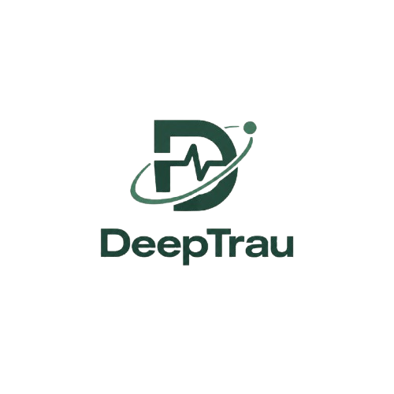
<sub><em>Visual logo &amp; icon generated with OpenAI GPT under team creative direction.</em></sub>

# DeepTrau SpaMedic

### Autonomous Local-First Aerospace Medical Monitoring, Visual Triage & Offline SOS Copilot

**Built for the 5 Hazards of Human Spaceflight (NASA HRP) · Operational Dosimetry Inspired by CSA · Bilingual `EN / ES`**

[](https://deeptrau-spamedic.netlify.app/)
[](#why-deeptrau-spamedic-matters)
[](package.json)
[](package.json)
[](CREDITS_AND_AI_AUDIT.md)

**[Try the Live Deployed MVP ➔ https://deeptrau-spamedic.netlify.app/](https://deeptrau-spamedic.netlify.app/)**

[Why It Matters](#why-deeptrau-spamedic-matters) · [Visual Tour of the App](#visual-tour-of-the-app) · [4 Mission Environments](#1-mission-adaptive-context-4-environments--ehr-intelligence) · [SOS Code Red Console](#6-sos-emergency-medical-console-sos) · [Judge Quickstart](#3-minute-judge-quickstart-guide) · [Local Setup](#local-development)

</div>

---

<p align="center">
  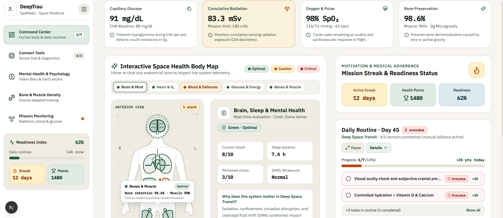
</p>

> **Zero login barriers. Zero external servers required during crisis. Zero paid libraries.**  
> **DeepTrau SpaMedic** turns complex aerospace telemetry, clinical history (EHR), behavioral health, radiation dosimetry, and zero-gravity emergency protocols into one calm, self-explanatory workspace that any crew member can operate millions of kilometers from Earth.

---

## Why DeepTrau SpaMedic Matters

**Why this is one of the most important health interfaces ever designed for deep-space exploration—and isolated communities on Earth:**

1. **When Earth is 20 to 40 minutes away by radio, live telemedicine stops working.**  
   Beyond Low Earth Orbit—on **Artemis lunar transits** or **Mars trajectories**—a single *"Wait, what should I do right now?"* message takes up to **40 minutes round-trip**. During hypovolemic syncope, hypoglycemic shock, cranial pressure spike, or a solar particle event, waiting for Flight Control is fatal. DeepTrau puts **deterministic, Local-First clinical triage** directly in the cabin.

2. **Astronauts are engineers, pilots, and geologists—not always flight surgeons.**  
   Instead of dumping raw tables (`4,450 cells/µL`, `83.3 mSv`), DeepTrau pairs a **Green / Amber / Red interactive anatomical body map** with plain-language explanations answering three survival questions: *What is happening?*, *Why does it matter in this gravity/radiation environment?*, and *What exact action do I take right now?*

3. **Real medicine is personal—never one-size-fits-all.**  
   The same capillary glucose (`82 mg/dL`) or leukocyte count (`4,450 cells/µL`) carries totally different risk depending on **who** the astronaut is and **where** they are. DeepTrau cross-checks **pre-flight EHR profiles** (blood type `O-`, `Penicillin` / `Synthetic latex` allergies, `Low Defenses` leukopenia predisposition, prior meniscus or rotator cuff surgeries, and personal metabolic baselines) against **4 distinct space environments**—automatically substituting joint exercises and adjusting drug contraindications during SOS emergencies.

4. **Built to keep working even when medical hardware fails.**  
   Inside a pressurized surface rover or after a sensor failure, crew members cannot simply order a replacement device. Switching off any sensor in the **Sensor Hub** automatically transforms daily checklist tasks into **structured manual clinical exams** (radial pulse checks, mucus inspection, Amsler visual grids for SANS, and muscle tape measurements).

5. **Designed for Mars. Vital for Earth.**  
   Every capability built for incomunicado astronauts directly protects **rural clinics without physicians, Antarctic research bases, submarines, maritime vessels, and disaster zones**—powered by lightweight, open-source browser technology that runs offline without proprietary subscriptions.

---

## Visual Tour of the App

### 1. Mission-Adaptive Context: 4 Environments & EHR Intelligence

Before monitoring begins, DeepTrau configures radiation limits (`mSv`), gravity profiles (`0g`, `0.16g`, `0.38g`), Earth link latency, onboard sensor availability, and exercise load around the active mission:
- **Deep Space Transit Spacecraft** (`0g Microgravity` · `12 to 20 min one-way` delay · **Radiation: Extreme**)
- **Planetary or Lunar Habitat** (`0.16g Lunar / 0.38g Martian` · `3 s to 14 min` delay · **Radiation: High**)
- **Orbiting Space Station** (`0g Continuous Microgravity` · `1 to 3 sec` real-time · **Radiation: Moderate**)
- **Pressurized Surface Rover** (`0.16g / 0.38g Mobile Ops` · `45s - 5 min` tactical link · **Radiation: High**)

<p align="center">
  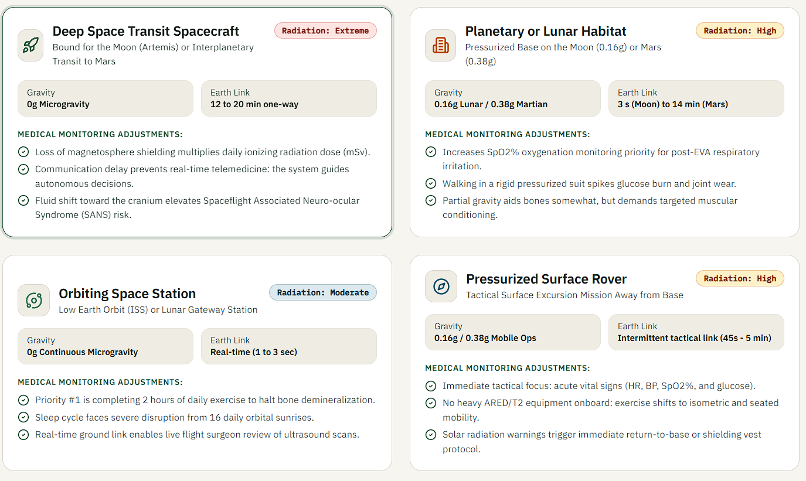
</p>

Each mission combines with pre-loaded or editable **Astronaut Clinical History (EHR)** profiles (`Cmdr. Elena Vance`, `Dr. Mateo Silva`, `Eng. Sofía Chen-Ramírez`) to customize leukocyte thresholds, post-EVA hypoglycemia alerts, joint-safe exercise substitutions, and allergy warnings.

---

### 2. Command Center: Interactive SVG Body Map, Plain-Language Triage & Adherence

A custom-crafted **Interactive Space Health Body Map SVG** lets non-medical crew hover or click across 5 physiological systems (**Brain & Mind**, **Heart & O₂**, **Blood & Defenses**, **Glucose & Energy**, **Bones & Muscle**) plus anatomical pins for surgical history (e.g., *Surgical History: Right knee*), paired with live KPI cards and gamified adherence tracking.

<table>
  <tr>
    <td width="48%" valign="top">
      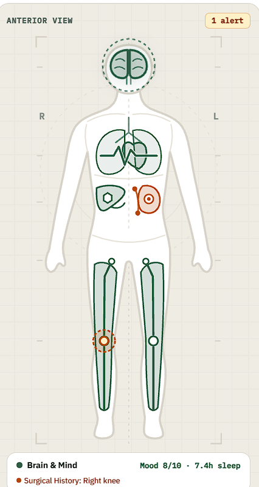
      <p align="center"><em>Interactive 5-system SVG body scanner with Green/Amber/Red triage and surgical knee pin.</em></p>
    </td>
    <td width="52%" valign="top">
      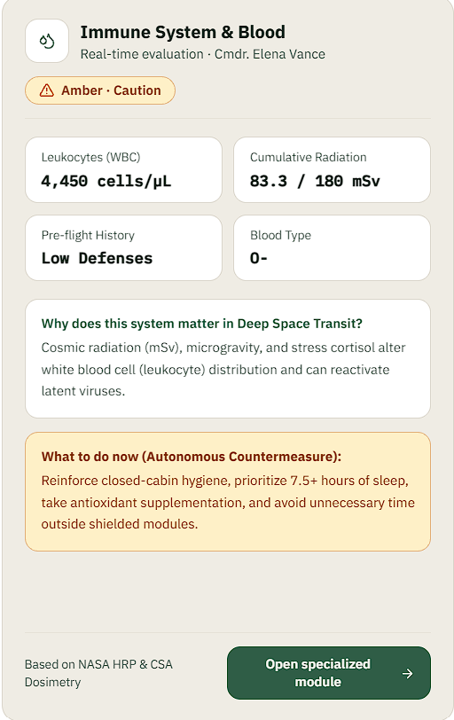
      <p align="center"><em>Plain-language diagnostic card answering why each hazard matters and what countermeasure to execute now.</em></p>
    </td>
  </tr>
  <tr>
    <td width="50%" valign="top">
      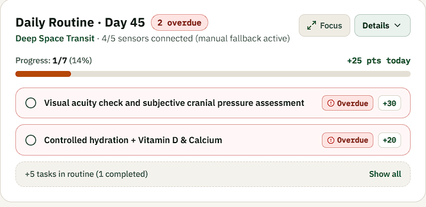
      <p align="center"><em>Adaptive daily routine checklist highlighting overdue & high-priority checks plus manual fallbacks.</em></p>
    </td>
    <td width="50%" valign="top">
      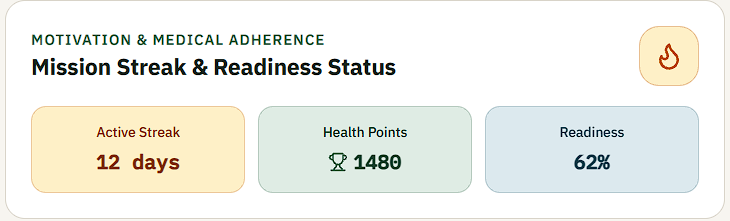
      <p align="center"><em>Crew adherence gamification tracking Active Streak, Health Points, and Readiness %.</em></p>
    </td>
  </tr>
</table>

---

### 3. Zero-Guesswork Sensor Hub & Sensorless Resilience

DeepTrau integrates **6 medical telemetry streams** (`vitals_cuff`, `dosimeter`, `glucometer`, `hematology`, `ultrasound`, `eva_spirometer`). Every device includes a **4-step Astronaut Measurement Protocol**, equipment self-diagnostics (`Run full diagnostics`), image upload for **Portable Multi-Organ / SANS Ultrasound**, and an instant **Manual Clinical Fallback (no hardware)** banner whenever a sensor goes offline.

<p align="center">
  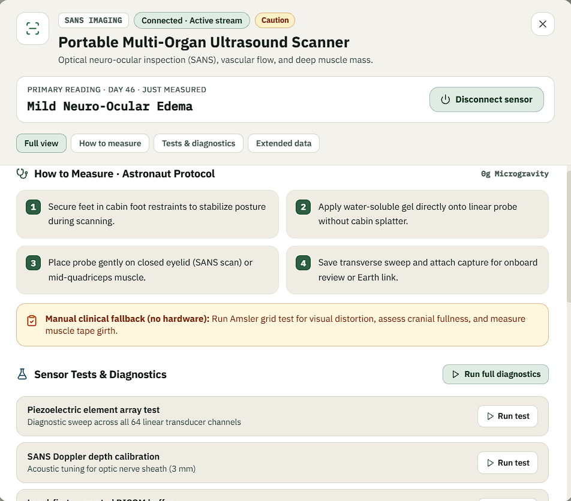
</p>

---

### 4. Mission Survival: CSA Radiation Dosimetry (`mSv`), Glucose & Leukocytes

Built around operational radiation monitoring concepts from the **Canadian Space Agency (CSA)** and **NASA Human Research Program (HRP)**, the `Mission Monitoring` workspace lets astronauts inspect every mission day along custom interactive SVG curves:

<p align="center">
  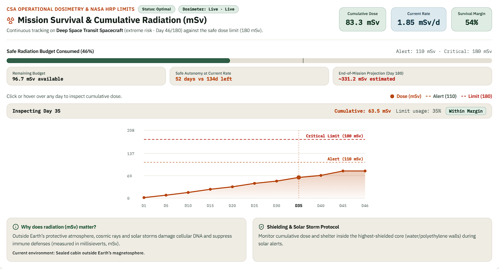
</p>

<table>
  <tr>
    <td width="52%" valign="top">
      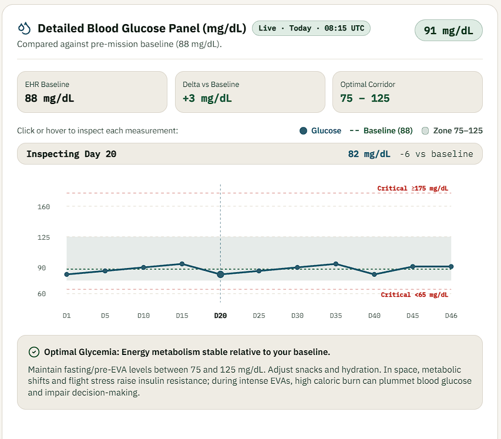
      <p align="center"><em>Capillary glucose (<code>mg/dL</code>) corridor compared against personal pre-flight EHR baseline to prevent EVA hypoglycemia.</em></p>
    </td>
    <td width="48%" valign="top">
      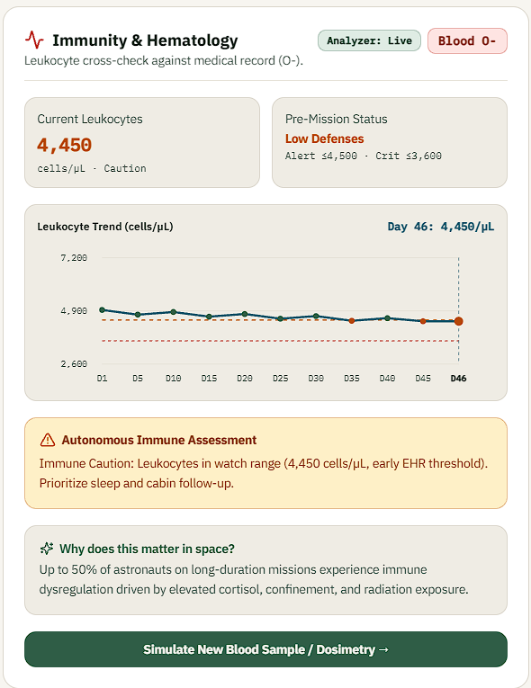
      <p align="center"><em>Leukocyte trend (<code>cells/µL</code>) triggering early caution alerts for astronauts flagged with pre-flight <code>Low Defenses</code>.</em></p>
    </td>
  </tr>
</table>

---

### 5. Confinement Psychology, Multimodal Capture & "My Earth Anchor"

Addressing the NASA HRP **"Third-Quarter Phenomenon"** and neurobehavioral risks using keyboard, mouse-click reaction latency, camera/microphone, and native Web Audio bioacoustics:

<p align="center">
  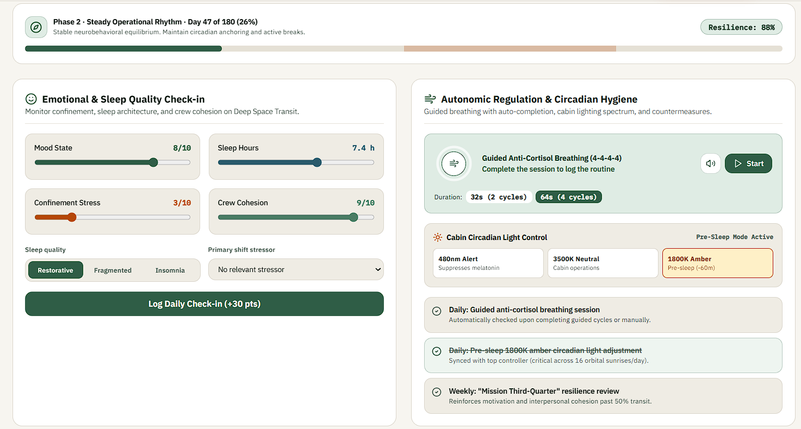
</p>

<table>
  <tr>
    <td width="50%" valign="top">
      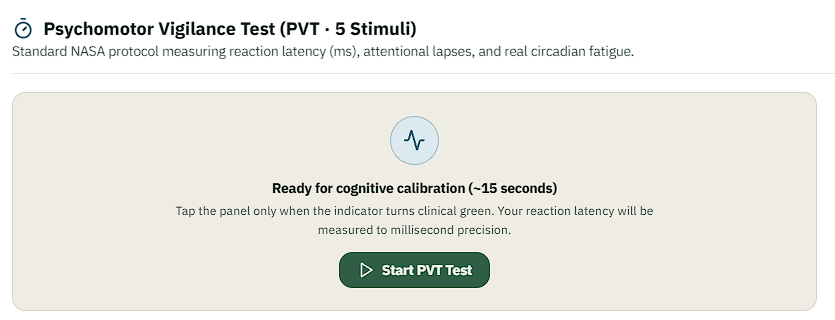
      <p align="center"><em><strong>NASA PVT (5 Stimuli):</strong> Precision millisecond reaction latency testing for circadian fatigue.</em></p>
    </td>
    <td width="50%" valign="top">
      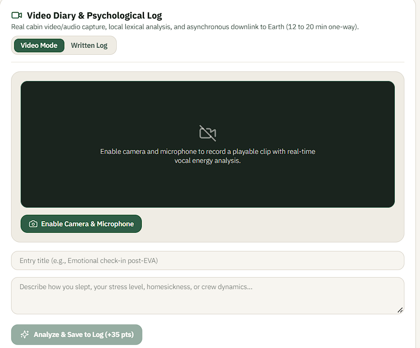
      <p align="center"><em><strong>Video Diary & Voice Log:</strong> Real <code>getUserMedia</code> capture with local lexical analysis and delayed Earth downlink.</em></p>
    </td>
  </tr>
</table>

<p align="center">
  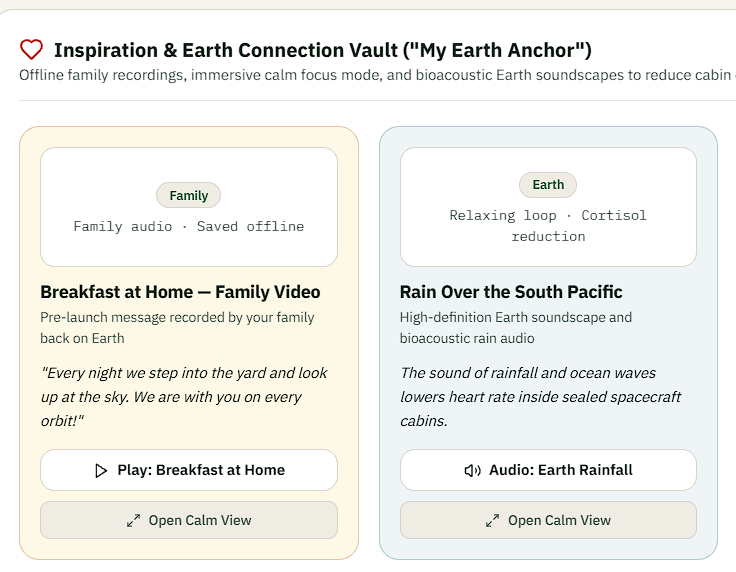
</p>

> **Offline Emotional Countermeasure (AI-Generated Audio):** *"My Earth Anchor"* bundles two AI-synthesized English audio assets generated in November 2026 via **Google Gemini (Lyria / Lyria 3)** (`public/audio/carta_de_voz.mp3` — *"Bridge Back Home"*, 60 BPM; `public/audio/video_familiar.mp3` — *"Breakfast at Home — Family Message"*, ~90 s, both with embedded C2PA & ID3v2.3 AI disclosure metadata) alongside procedural **Web Audio API** rain/ocean soundscapes and `1800K Amber` pre-sleep cabin lighting control.

---

### 6. SOS Emergency Medical Console (`/sos`)

When vitals cross critical thresholds or an astronaut activates **SOS EMERGENCY**, DeepTrau switches into a focused clinical stabilization workspace featuring **6 space-adapted Rapid Response Protocols** (*Seizure / Convulsion*, *Syncope / Fainting*, *Evetts-Russomano / Handstand Space CPR*, *Hypoxia / Air*, *Glucose / Thermal*, and *Trauma / FAST Ultrasound Scan*), an episode stopwatch, EHR allergy badges (`Allergy: Penicillin`), a targeted 3-zone mini anatomical scanner, and critical telemetry packet formatting for Flight Surgeons on Earth.

<p align="center">
  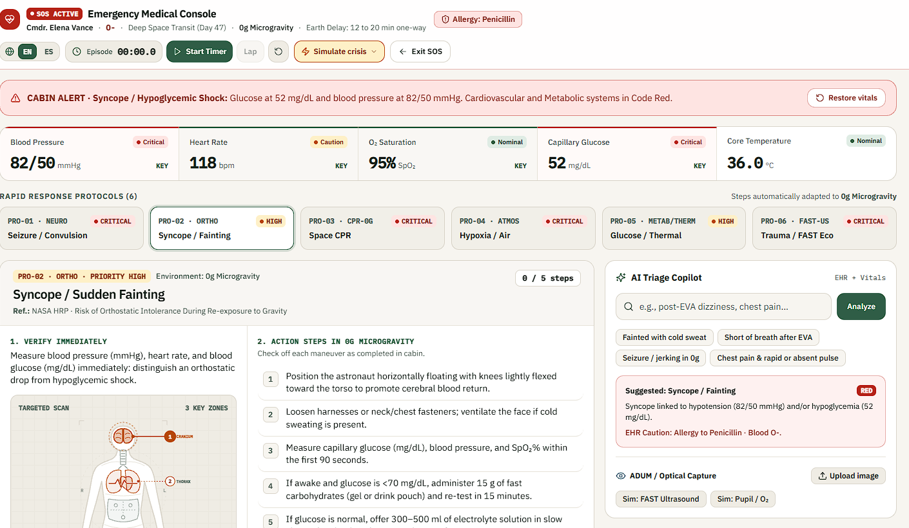
</p>

---

## Architecture & NASA / CSA Scientific Foundation

| Core Capability | Implementation in Repo | Scientific / Challenge Basis |
| :--- | :--- | :--- |
| **Local-First State & Persistence** | [`MissionContext.tsx`](src/context/MissionContext.tsx) | React Context + `localStorage` persistence; works 100% offline with zero external DB |
| **Mission & Gravity Profiles** | [`missionsData.ts`](src/data/missionsData.ts) | 4 environments modeling `0g`, `0.16g`, `0.38g`, mSv dose rates, and 1s–20m one-way comm lag |
| **EHR Intelligence & Validation** | [`astronautsData.ts`](src/data/astronautsData.ts), [`astronautValidation.ts`](src/utils/astronautValidation.ts) | Cross-checks blood type, `Low Defenses`, surgical joints, allergies, and baseline vitals |
| **Visual Body Map & Risk Briefing** | [`InteractiveBodyMap.tsx`](src/components/dashboard/InteractiveBodyMap.tsx), [`missionRiskAnalysis.ts`](src/utils/missionRiskAnalysis.ts) | Color-coded 5-system anatomical SVG + shift briefing for overdue & urgent tasks |
| **Sensor Hub & Manual Fallback** | [`SensorHubTab.tsx`](src/components/sensors/SensorHubTab.tsx), [`SensorDetailModal.tsx`](src/components/sensors/SensorDetailModal.tsx) | 4-step instructions + ultrasound image loader + automatic non-hardware clinical exams |
| **CSA Radiation & Survival Charts** | [`MissionMonitorTab.tsx`](src/components/survival/MissionMonitorTab.tsx) | Native `<svg>` interactive curves for cumulative `mSv`, capillary `mg/dL`, and leukocyte trend |
| **Bone & Muscle Countermeasures** | [`BoneMuscleTab.tsx`](src/components/musculoskeletal/BoneMuscleTab.tsx) | Gravity-adapted ARED/T2/CEVIS routines, countdown timer, and BMD retention curves (`-1.5%/mo` baseline) |
| **Behavioral Health & Earth Anchor** | [`MentalHealthTab.tsx`](src/components/psychology/MentalHealthTab.tsx), [`PvtCognitiveTestCard.tsx`](src/components/psychology/PvtCognitiveTestCard.tsx), [`VideoDiaryStudio.tsx`](src/components/psychology/VideoDiaryStudio.tsx), [`EarthAnchorVault.tsx`](src/components/psychology/EarthAnchorVault.tsx) | PVT ms latency, WebRTC camera/mic studio, 4-4-4-4 breathing, 1800K lighting, Web Audio soundscapes |
| **SOS Emergency & AI Triage Copilot** | [`SosCommandWorkspace.tsx`](src/components/emergency/SosCommandWorkspace.tsx), [`emergencyProtocolsData.ts`](src/data/emergencyProtocolsData.ts), [`src/app/sos/page.tsx`](src/app/sos/page.tsx) | NASA ExMC / ESA Space CPR, ADUM FAST ultrasound, ISS JSC-48522 protocols, EHR allergy guardrails |

---

## Zero-License-Cost Tech Stack

Following a strict **minimal-dependency, zero-paid-license architecture** (see full audit in [`CREDITS_AND_AI_AUDIT.md`](CREDITS_AND_AI_AUDIT.md)):

- **Framework:** `next` `^15.3.2` (MIT) + `react` / `react-dom` `^19.1.0` (MIT)
- **Language:** `typescript` `^5.8.3` (Apache 2.0)
- **Styling & Design System:** `tailwindcss` `^4.1.7` (MIT) + [`deeptrau_design_system.md`](deeptrau_design_system.md) mineral telemetry tokens (`#F7F5F0` / `#FFFFFF` / `#2F5D46` / `#B42318` / `#B54708`)
- **Typography:** `IBM Plex Sans` & `IBM Plex Mono` (`SIL Open Font License 1.1` via `next/font/google`)
- **Icons:** `lucide-react` `^0.511.0` (ISC)
- **Zero external UI/Chart/Motion/Audio SDKs:** All telemetry curves, body maps, CSS motion (`180ms cubic-bezier(0.2, 0, 0, 1)`), and cabin alerts are built natively with SVG and standard Web APIs (`Web Audio API`, `getUserMedia`, `FileReader`, `localStorage`).

---

## 3-Minute Judge Quickstart Guide

Open **[https://deeptrau-spamedic.netlify.app/](https://deeptrau-spamedic.netlify.app/)** (or run locally) and test the entire mission lifecycle cleanly—each browser session stays isolated via `localStorage`:

1. **Choose a Mission & Astronaut EHR:** Launch from the animated airlock welcome screen, pick any of the **4 Mission Environments** and **3 Astronaut Profiles** (`Cmdr. Elena Vance`, `Dr. Mateo Silva`, or `Eng. Sofía Chen-Ramírez`)—or return anytime via `Tests ➔ Switch Mission / Astronaut` or `Tests ➔ From Home`.
2. **Test Sensorless Resilience:** Open **Connect Tools**, disconnect any onboard monitor (e.g., *Dosimeter* or *Ultrasound*), and return to **Command Center** to watch routine checks adapt to manual clinical protocols.
3. **Inspect Live Telemetry Curves & Behavioral Tools:** Hover or click day markers inside **Mission Monitoring** (`mSv`, `mg/dL`, leukocytes) and try the **PVT Reaction Test** or **4-4-4-4 Breathing** inside **Mental Health & Psychology**.
4. **Trigger Code Red:** Click **`Simulate Crisis ➔ 1. Syncope / Hypoglycemic Shock`** (or **`Tests ➔ Simulate: Solar Storm`**) in the top telemetry bar to enter the full **SOS Emergency Medical Console** (`/sos`) with active allergy warnings and 0g action steps.
5. **Switch Languages Live:** Toggle **`EN | ES`** anytime from the top telemetry bar or welcome screen.

---

## Local Development

```bash
# 1. Clone the repository
git clone https://github.com/DivergenteNM/DeepTrau_SpaMedic.git
cd DeepTrau_SpaMedic

# 2. Install dependencies
npm install

# 3. Start the development server
npm run dev
```

Open [http://localhost:3000](http://localhost:3000) in your browser (SOS workspace also accessible directly at [http://localhost:3000/sos](http://localhost:3000/sos)).

## AI Transparency & Simulated Data Disclosure

- **Code, Architecture & Pitch Deck:** Application source code, UI components, simulated clinical/EHR datasets, and presentation structuring (`PITCH_DECK_CANVA_7_SLIDES.md`) were developed with AI coding assistance (**Google Antigravity**) under team supervision and grounded in public **NASA**, **CSA**, and **ESA** space medicine literature.
- **Audio Assets:** *"Bridge Back Home"* (`public/audio/carta_de_voz.mp3`) and *"Breakfast at Home — Family Message"* (`public/audio/video_familiar.mp3`) were synthesized with **Google Gemini (Lyria / Lyria 3, Nov 2026)** and carry embedded C2PA and ID3v2.3 AI-disclosure metadata.
- **Visual Identity:** `public/DeepTrau_logo.webp` and `src/app/favicon.ico` were generated with **OpenAI GPT**.

For full AI usage disclosure, scientific citations (**NASA HRP**, **CSA**, **ESA**), and open-source dependency auditing, see [`CREDITS_AND_AI_AUDIT.md`](CREDITS_AND_AI_AUDIT.md).
